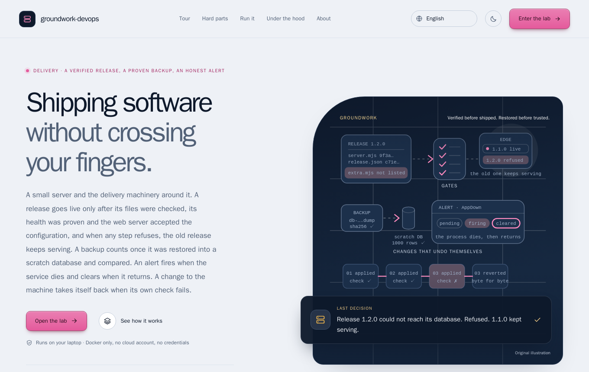
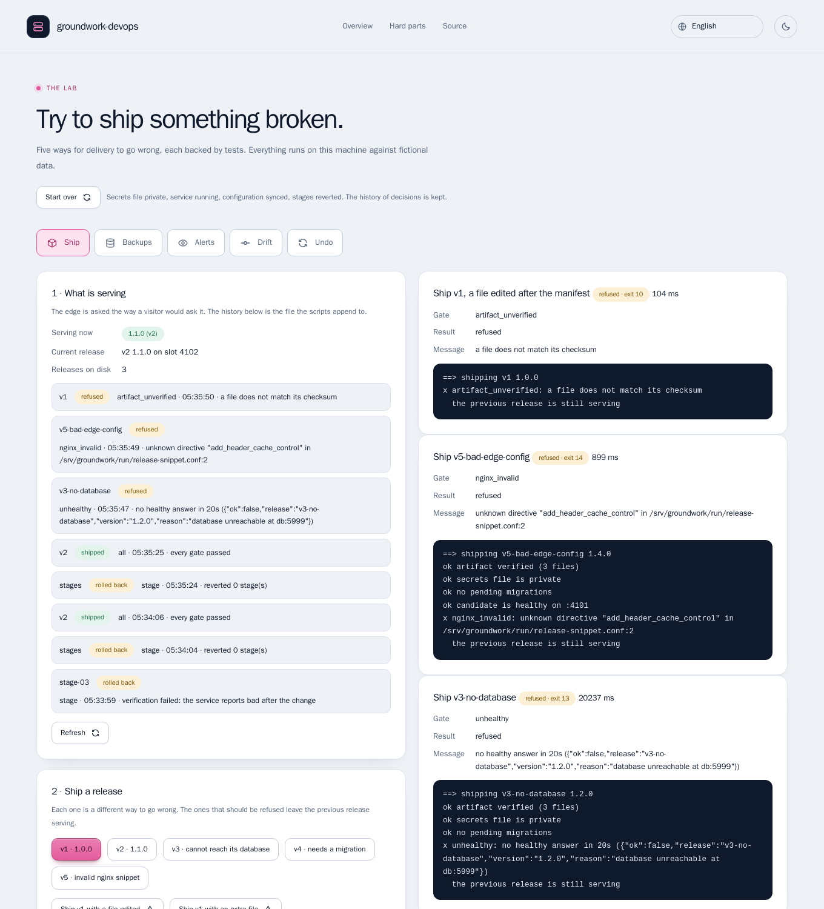
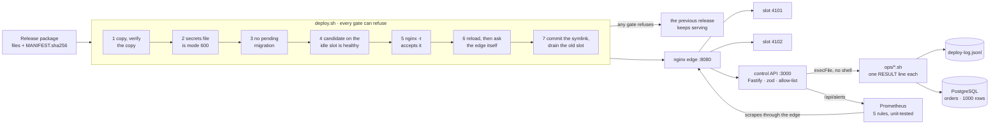
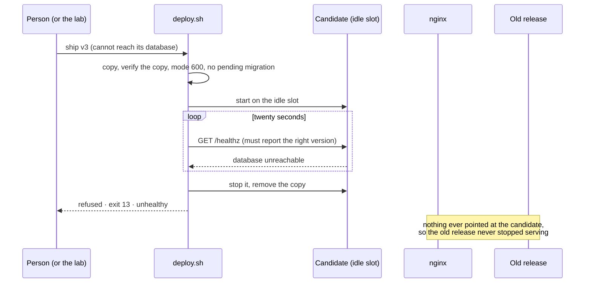

# groundwork-devops

> **Shipping software without crossing your fingers.** A small delivery pipeline you can break on purpose. A release goes
> live only after its files were checked, its health was proven and nginx accepted the configuration, and when any step
> refuses, **the old release keeps serving**. A backup counts once it was **restored into a scratch database and compared**.
> An alert fires when the service dies and clears when it returns. A change to the machine **takes itself back** when its own
> check fails.

[](https://github.com/MenoDK/groundwork-devops/actions/workflows/ci.yml)




The landing page and the lab are available in **14 languages** (English, 中文, हिन्दी, Español, Français, العربية, বাংলা,
Português, Русский, اردو, Bahasa Indonesia, Deutsch, 日本語, 한국어), including right-to-left layouts: open `/?lang=ja` or use
the selector in the header. The lab body, the decision records and this README stay in English; the translations were written
for this project and a native review is welcome.

## Run it in a minute

You need **Docker** (Compose v2), `make`, `openssl` and `curl` (plus `jq` for `make smoke` and the snippets below). No cloud
account, no credentials, nothing to download besides the images; nothing leaves your machine.

```bash
git clone https://github.com/MenoDK/groundwork-devops.git
cd groundwork-devops
make up              # writes .env with a fresh random database password, builds one image, starts PostgreSQL and Prometheus, ships release 1.0.0
```

Open **http://localhost:8100**. The page explains the project and opens the **lab**, where every hard part below can be
tried from a browser. The port is published on loopback only, because the lab has no login on purpose
([ADR 0005](docs/adr/0005-a-bash-core-and-a-typed-api.md)). Stop with `make down`; `make reset` also deletes the releases,
the backups and the database.



*Above: a release that cannot reach its database, one with an invalid nginx snippet and one changed after its manifest was
written. All three are refused, each by a different gate and with a different exit code, and the edge keeps answering 1.1.0.*

## What to try

In the lab, or from a terminal against the same server (the lab buttons call these routes):

```bash
B=http://localhost:8100

# 1. ship a good release, then one that cannot reach its database: the candidate starts, fails its health check, is stopped
curl -s -X POST $B/api/lab/ship -H 'content-type: application/json' -d '{"variant":"v2"}'  | jq '{ok,gate,result}'
curl -s -X POST $B/api/lab/ship -H 'content-type: application/json' -d '{"variant":"v3-no-database"}' | jq '{ok,exitCode,gate,message}'
curl -s $B/app/version                                  # still 1.1.0: the refused release never took over

# 2. a backup is proven by restoring it; a copy with one flipped byte fails on its checksum before anything is restored
curl -s -X POST $B/api/lab/backups/take -H 'content-type: application/json' -d '{}' | jq .message

# 3. kill the live process and watch the alert: AppDown fires after fifteen seconds of failed scrapes, then clears
curl -s -X POST $B/api/lab/app -H 'content-type: application/json' -d '{"action":"stop"}' | jq .message
curl -s $B/api/alerts | jq '.alerts[] | {name,state}'
curl -s -X POST $B/api/lab/app -H 'content-type: application/json' -d '{"action":"start"}' | jq .message
```

### Run the checks

```bash
make check       # biome + tsc, the API tests, the shell tests (real nginx, real PostgreSQL), promtool, shellcheck, Terraform/Helm validation
make smoke       # 34 checks against the running stack, one of them an alert firing and clearing
make e2e         # browser tests with accessibility scans, in a container, against the real container
make sabotage    # breaks each gate on purpose (40 times) and requires a test to go red
```

## What it is

Shipping software is a handful of things that each go wrong in a known way: a package that changed on the way, a release that
starts and cannot reach its database, a configuration nginx rejects, a backup nobody ever restored, a service that dies without
anyone noticing, a server edited by hand at 3 a.m., a hardening step that breaks the thing it hardens. `groundwork-devops` is
the small, honest version of the machinery that handles each one. Every step is a script with a name, an exit code and a
refusal path; every refusal leaves the previous state in place; and every claim on the page has a test, and most have a mutant.

It is deliberately not a platform. One container plays "a server" so you can break it without consequences; the sample service
is trivial on purpose; the Terraform module and the Helm chart are validated and never applied. The order of the gates is the
one you would use on a VPS.

## Architecture





### Design decisions

Every row has an ADR with **what was rejected and why**. Open one when you wonder "why not just…".

| Decision | Why it matters | Record |
|---|---|---|
| Verify the copy, not the source | What is checked has to be what will run; checking the source and then copying leaves a window | [ADR 0001](docs/adr/0001-verify-the-copy-not-the-source.md) |
| Two slots and a symlink | The candidate is proven beside the release that is serving; the switch is a reload and a rollback is a deploy through the same gates | [ADR 0002](docs/adr/0002-two-slots-and-a-symlink.md) |
| A backup is proven by restoring it | `pg_dump` exiting 0 says a file was written; a restore into a scratch database, compared row by row, says it works | [ADR 0003](docs/adr/0003-a-backup-is-proven-by-restoring-it.md) |
| Changes that take themselves back | A stage runs its own check and reverts if it fails; the revert is compared byte for byte | [ADR 0004](docs/adr/0004-changes-that-take-themselves-back.md) |
| A bash core and a typed API | Orchestrating nginx, processes and `pg_dump` is shell's job; the API validates, allow-lists and never builds a command line | [ADR 0005](docs/adr/0005-a-bash-core-and-a-typed-api.md) |
| A firewall in the chain Docker respects | UFW rules filter nothing for a published port; the rules belong in `DOCKER-USER`, and the script only prints them | [ADR 0006](docs/adr/0006-a-firewall-in-the-chain-docker-respects.md) |

### The API

The control API serves the site and runs the scripts. `GET` routes only read; everything that changes something is under
`/api/lab/*`, which answers `404 lab_disabled` unless the server was started with `GW_LAB=1`.

| Route | What it does |
|---|---|
| `GET /api/health` | `{ok, lab}` |
| `GET /api/overview` | environment, whether the lab is on, the live release, the releases on disk, the latest decisions |
| `GET /api/deploys` · `/api/backups` · `/api/drift` · `/api/stages` | the history of decisions, the backups with their row counts, the drift between the server and the repository, the stages and which are applied |
| `GET /api/alerts` | the five rules and their state from Prometheus, and whether both scrape targets are up |
| `GET /metrics` | what the delivery machinery knows about itself (deploys by outcome, backups, drills, drift) |
| `POST /api/lab/ship` `{variant, tamper?}` · `rollback` · `migrate` · `env-mode` | deploy a sample release (optionally tampered), roll back, apply a migration, change the secrets file's mode |
| `POST /api/lab/backups/take` · `drill` · `rotate` · `damage` | take, restore-and-compare, rotate, damage a *copy* |
| `POST /api/lab/app` `{action}` · `drift/edit` · `drift/sync` | stop or start the live process, edit the live configuration by hand, put the repository's version back |
| `POST /api/lab/stages/apply` · `revert` · `health` | apply or revert a stage, make the service unwell or well |

Every script answer has the shape `{ok, exitCode, gate, result, message, release, detail, steps}`. A foreign `Host` header
answers `403 host_not_allowed`; a change from another origin answers `403 origin_not_allowed`.

## Resources

| Service | Image | Port | Memory at rest | Purpose |
|---|---|---|---|---|
| `host` | built from `Dockerfile` (multi-stage; nginx runs non-root; read-only root filesystem, `/tmp` in memory, all capabilities dropped, `no-new-privileges`) | `127.0.0.1:8100` → 8080 | ~60 MiB | nginx edge, control API, the sample service and the scripts: "a server" |
| `db` | `postgres:15-bookworm` | internal | ~57 MiB | the database the backups protect; `orders` has 1000 rows |
| `prometheus` | `prom/prometheus:v2.55.1` | internal | ~28 MiB | scrapes the sample service and the control API through the edge; evaluates the five rules |
| `e2e` | `mcr.microsoft.com/playwright` (profile `e2e`) | shares the host's network | — | browser tests with accessibility scans |

Memory is `docker stats` on 2026-11-05, with the stack idle. The `host` image is 651 MB because it carries nginx, the
PostgreSQL client tools, Node and the shell tooling a server would have; it is the price of "one container plays a server".
The releases, backups and history live in the `gwdata` volume, the database in `dbdata`.

### Configuration

The ones worth knowing; the full list is `src/config.ts` and `.env.example`.

| Variable | Default | Meaning |
|---|---|---|
| `POSTGRES_PASSWORD` | — (required) | The demo database's password. `make env` writes a random one into `.env` |
| `GW_LAB` | off | The lab; **refused when `GW_ENV=production`** |
| `GW_ENV` | `development` | `development` or `production`; anything else is an error, not a silent default |
| `GW_PORT` | `8100` | The port the site is published on, always on `127.0.0.1` |
| `GW_ALLOWED_HOSTS` | loopback names | Extra `Host` names the control API answers to; everything else gets `403` (defeats DNS rebinding). Compose sets `host` so Prometheus can scrape |
| `GW_KEEP` · `GW_HEALTH_TIMEOUT` · `GW_DRAIN` | `3` · `20` · `1` | Releases kept on disk, seconds a candidate has to become healthy, seconds the old slot drains |
| `GW_PROMETHEUS_URL` | unset | Where the API asks about alerts. Unset, the Alerts tab says there is nothing to show |

## Testing

| What | Count | How |
|---|---|---|
| Shell tests | **57** | `bats` against a real nginx and a real PostgreSQL: every gate, in both directions. 120 requests are sent while one release replaces another and every one must be a 200 |
| API tests | **41** | `vitest`: the allow-list, the Host and Origin checks, the lab being refused in production and absent without its flag |
| Alert rules | **8** unit tests | `promtool test rules`: when each of the five fires, and when it must stay quiet |
| Mutation check | **40 of 40** caught | `make sabotage` rewrites one line of one gate in a *copy* (a checksum not compared, `nginx -t` skipped, a revert not proven, a foreign Host served, an alert that can never fire, …) and a test must go red |
| Smoke | **34** checks | `scripts/smoke.sh` against the running stack, including AppDown firing and clearing and both scrape targets being up |
| Browser tests | **52** | Playwright: every hard part above, 14 languages, axe scans of the landing page and each lab tab in both colour schemes |
| Static | clean | `shellcheck` on every script, `biome`, `tsc --strict`, `hadolint`, `actionlint`, `gitleaks`, `terraform validate`, `helm lint`, `kubeconform` |

The landing page's guided tour is **recorded from the running stack** (`make transcripts`), and CI fails if the recording
drifts from what the scripts really answer.

Things running the real stack found that no unit test had: a deploy lock that outlived its deploy because a child process
inherited the file descriptor; a test helper that stopped nginx in a way that parsed the configuration the test had just
broken, and hung; a sabotage script that once left a mutated source file behind (it now works only on copies); and a
Prometheus scrape target that had been refused with a 403 since the first run, because the control API's Host guard did not
know the name Prometheus reaches it by. The smoke test now fails if any scrape target is down.

## Limitations

Stated up front, because a showcase that hides them is worse than one that has them.

- **One container plays the server.** nginx, the control API and the release processes share it. The workflow that would run
  the same scripts over SSH is written and has never run against a real host.
- **The firewall script only prints.** It was never applied to a live netfilter, so what is tested is the output, not what a
  kernel does with it ([ADR 0006](docs/adr/0006-a-firewall-in-the-chain-docker-respects.md)).
- **Terraform and Helm are labelled new and were not applied.** `terraform validate`, `helm lint`, `helm template` and
  `kubeconform` pass; no cluster or account has seen them. **ArgoCD is not built.**
- **The stages run in a directory that stands in for `/etc`.** The mechanism (back up, change, check, restore, compare) is
  proven; the effect of those particular settings on a live host is not ([ADR 0004](docs/adr/0004-changes-that-take-themselves-back.md)).
- **The manifest proves integrity, not origin.** It says the package was not changed after the manifest was written, not who
  wrote it. A signature belongs in front of that check ([ADR 0001](docs/adr/0001-verify-the-copy-not-the-source.md)).
- **Nothing restarts a crashed release.** There is no process manager on purpose, so the lab can show what unsupervised looks
  like. A real host wants one ([ADR 0002](docs/adr/0002-two-slots-and-a-symlink.md)).
- **One unexplained 502.** Right after the very first deploy on a fresh stack, one request got a 502. It was not reproduced in
  about 600 requests. The likeliest cause is the reload window of that first deploy, while nginx still points at a placeholder
  upstream; that has not been proven. Every later release is covered by the 120-request test.
- **Backups sit on the volume they protect,** are point-in-time only (no WAL archiving), and the drill compares row counts, not
  row contents ([ADR 0003](docs/adr/0003-a-backup-is-proven-by-restoring-it.md)).
- **There is no Alertmanager and no Grafana.** The rules fire and clear; nothing pages anyone.
- **The lab has no authentication,** on purpose: it is refused in production, published on loopback, and the API checks `Host`
  and `Origin`. The sample service is trivial on purpose.

## Project layout

```
ops/             deploy, backup, migrate, drift, stage (+ stages/), firewall-docker, build-release, lib: one RESULT line each
src/  test/api/  the control API (Fastify 5, zod, strict TypeScript) and its vitest tests
test/ops/        bats tests against a real nginx and a real PostgreSQL
prometheus/      the five alert rules and their promtool unit tests
releases-src/    the five sample releases (two good ones, one that cannot reach its database, one that needs a migration, one with an invalid nginx snippet)
desired/         the configuration the repository owns, which drift is measured against
site/            landing page and lab, plain JS and CSS under a strict CSP; i18n/ holds 14 languages
infra/           Terraform module (AWS host) and Helm chart: new, validated, never applied
scripts/  e2e/   smoke test, mutation check, transcript recorder · Playwright tests
docs/adr/        six decision records with rejected alternatives
```

## License

MIT — see [LICENSE](LICENSE). Everything here is fictional data and original code.
